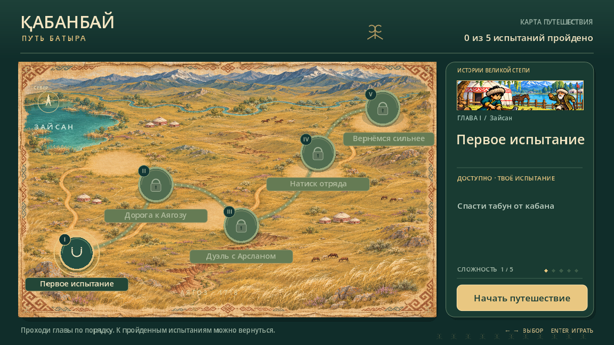
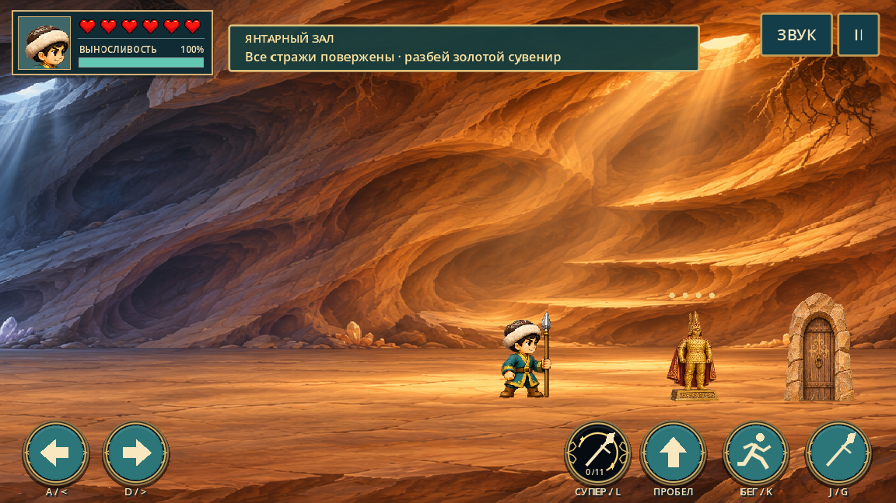

# Кабанбай — Путь батыра

Пиксельный платформер о юности и походах Кабанбая. Пять глав ведут от первого испытания у Зайсана до конного боя и дуэли у Аягоза. На карте следующий этап открывается после прохождения текущего.

[История обновлений](CHANGELOG.md) · [Редактирование в Godot](docs/РЕДАКТИРОВАНИЕ_В_GODOT.md) · [Игровые скриншоты](docs/screenshots)

## Открыть проект

1. Скачайте или клонируйте репозиторий.
2. В менеджере проектов Godot 4.7.2 выберите **Импорт** и укажите `project.godot`.
3. Нажмите **F5**, чтобы открыть карту кампании. Для редактирования главы откройте её сцену в панели «Файловая система». **F6** запускает открытую сцену напрямую.

| Сцена | Содержимое |
| --- | --- |
| [main.tscn](scenes/main.tscn) | I. Первое испытание |
| [level_two.tscn](scenes/level_two.tscn) | II. Дорога к Аягозу |
| [level_three.tscn](scenes/level_three.tscn) | III. Дуэль с Арсланом |
| [level_four.tscn](scenes/level_four.tscn) | IV. Натиск отряда |
| [level_five.tscn](scenes/level_five.tscn) | V. Вернёмся сильнее |
| [campaign_map.tscn](scenes/campaign_map.tscn) | Карта кампании |

В дереве главы откройте **Layout**, чтобы двигать врагов, декор, платформы, овраги и двери в редакторе 2D. Размеры, движение и условия столкновений настраиваются в инспекторе.

## Управление

| Действие | Клавиши |
| --- | --- |
| Шаг | A/D или стрелки |
| Бег | K вместе с направлением |
| Прыжок | Пробел |
| Копьё на земле или удар ногой в воздухе | J или G |
| Суперудар после 11 обычных попаданий | L |
| Войти или выйти | E или касание двери |

## Что есть в игре

- Конная разведка, дуэль в две фазы, пешие лагеря с волнами подкреплений и лучниками.
- Зелёные берега Зайсана, овраги без мостов, камни в мелководье и проходные юрты.
- Пещеры под провалами, асыки на тропах и пластинчатые доспехи со второй главы.
- Три возраста героя, контрольные точки, выносливость и короткие испытания на боковых маршрутах.

## Публикация браузерной версии

[Играть в браузере](https://missalimovdanial.github.io/qabanbay/)

GitHub Pages публикует готовый Web-экспорт из ветки `web-build`. После изменения игры экспортируйте проект с пресетом **Web** в Godot 4.7.2 и обновите файлы в этой ветке. Затем откройте **Actions → Publish game to GitHub Pages → Run workflow** и выберите ветку `main`.
